# Buzzle — cozy hive + honeycomb puzzle

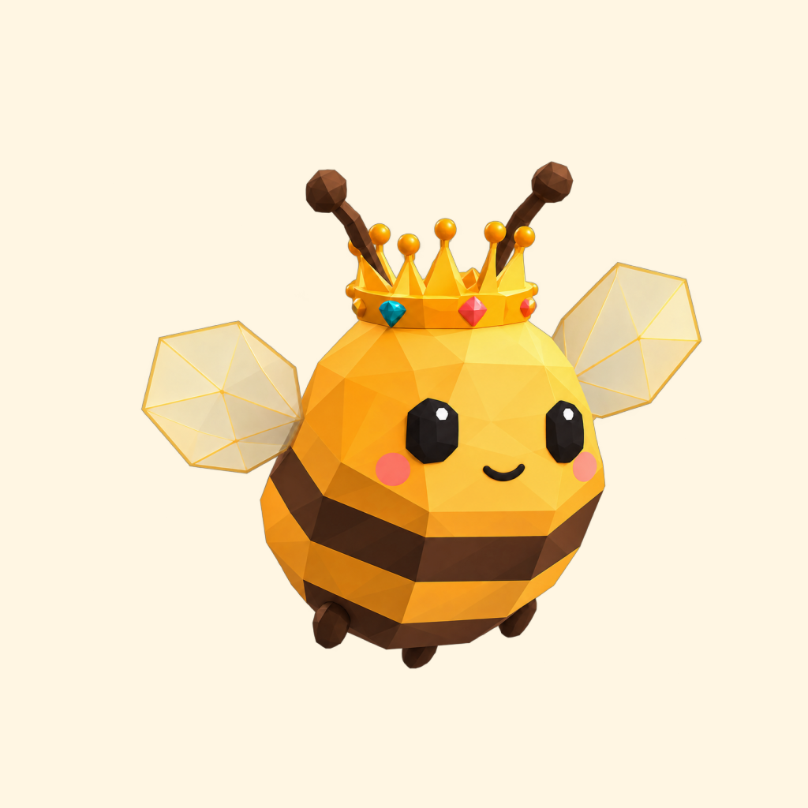

**Buzzle** is a cozy portrait-mode casual game for Android and Telegram. You grow a bee hive that makes honey even
while the app is closed, tend a small flower garden, and earn more by solving a daily hexagonal honeycomb puzzle.
There is no account, no ads and nothing to buy. Progress is stored on the device (and in Telegram CloudStorage when
played in Telegram). The game is available in English, Ukrainian and Russian.

Current version: **1.5.0-dev** (branch `v1.5-ui`, versionCode 19), a UI/UX refresh with new "honey crystal" art. The last stable release is **1.4.1** (`main`); the dev APK is published as the pre-release [`v1.5.0-dev`](https://github.com/InM1nd/buzzle/releases/tag/v1.5.0-dev) and is not offered by the in-app updater.

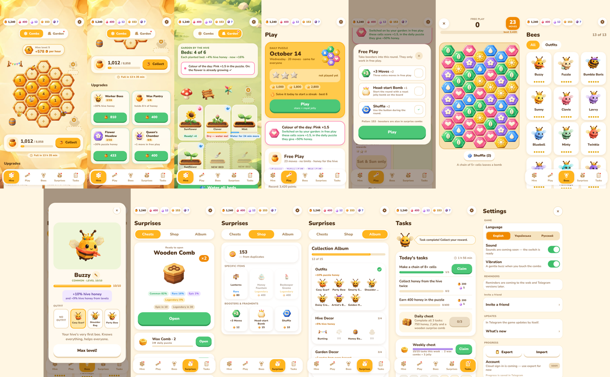

## Screenshots (v1.5)

| Hive | Upgrades | Garden | Play | Free-play boosters |
|---|---|---|---|---|
| 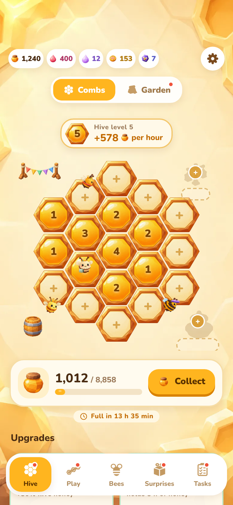 | 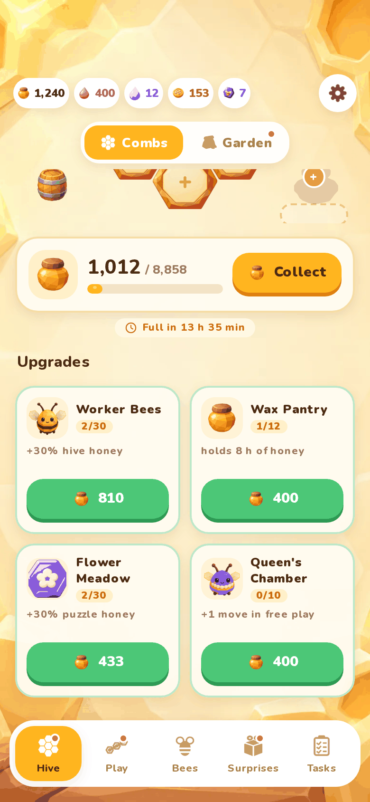 | 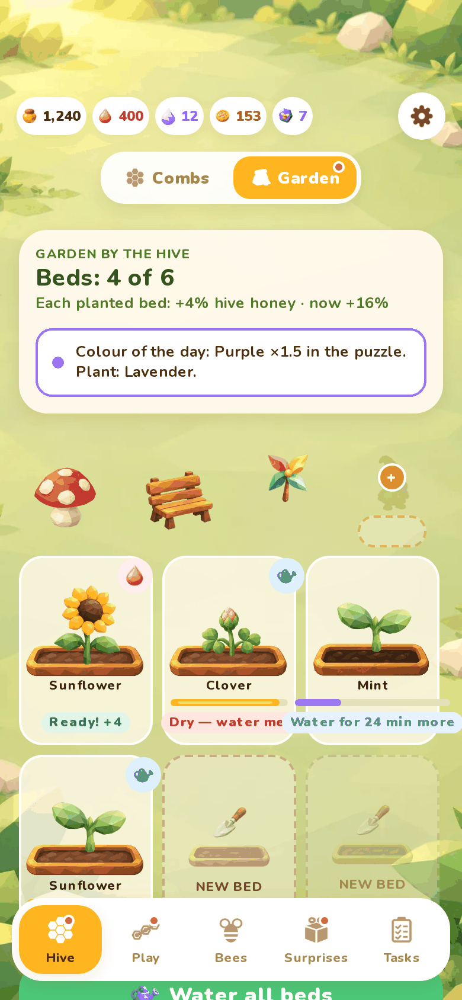 | 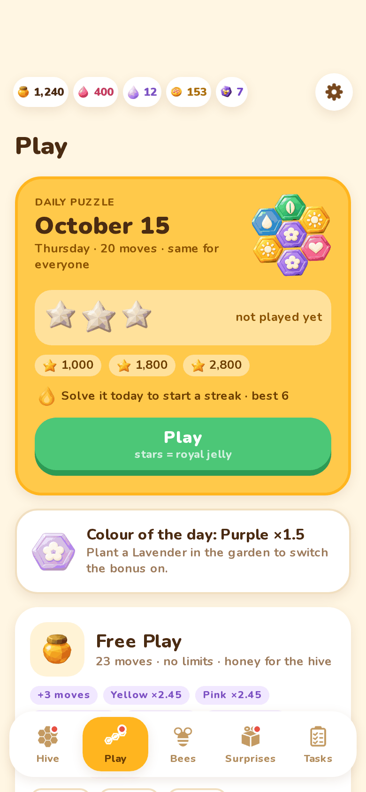 | 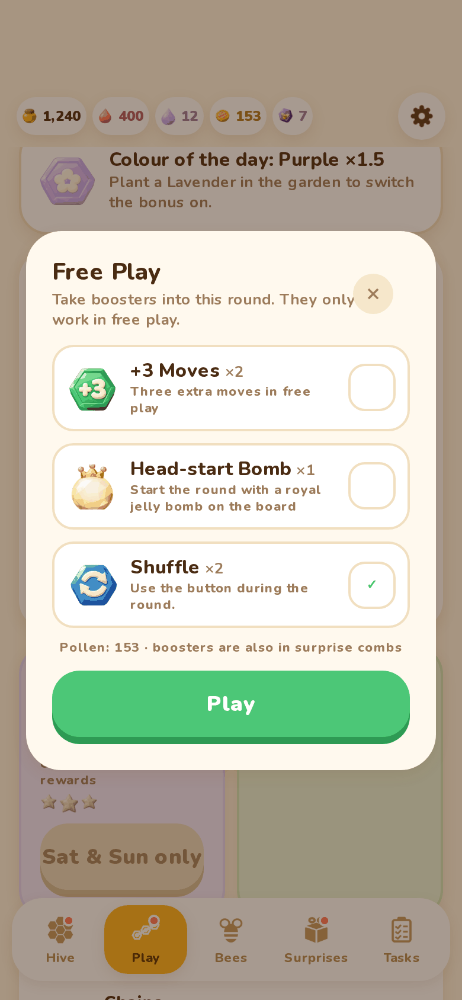 |

| Puzzle round | Bees | Bee card | Surprise combs | Shop |
|---|---|---|---|---|
| 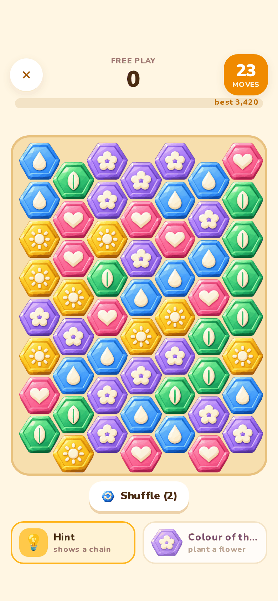 | 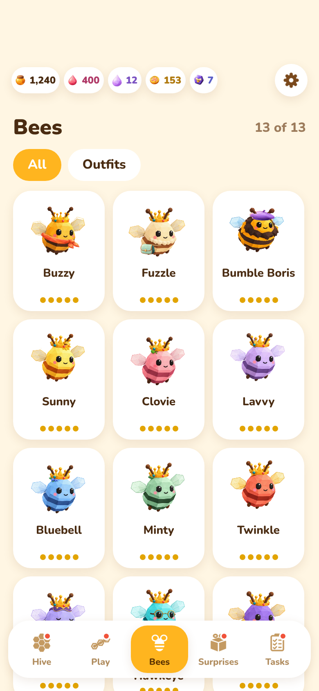 | 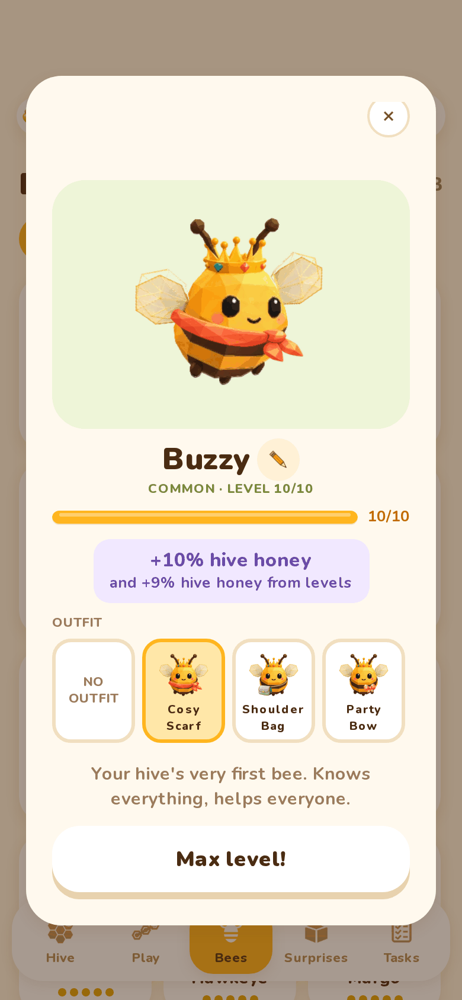 | 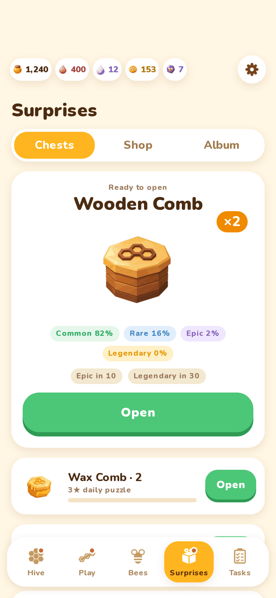 | 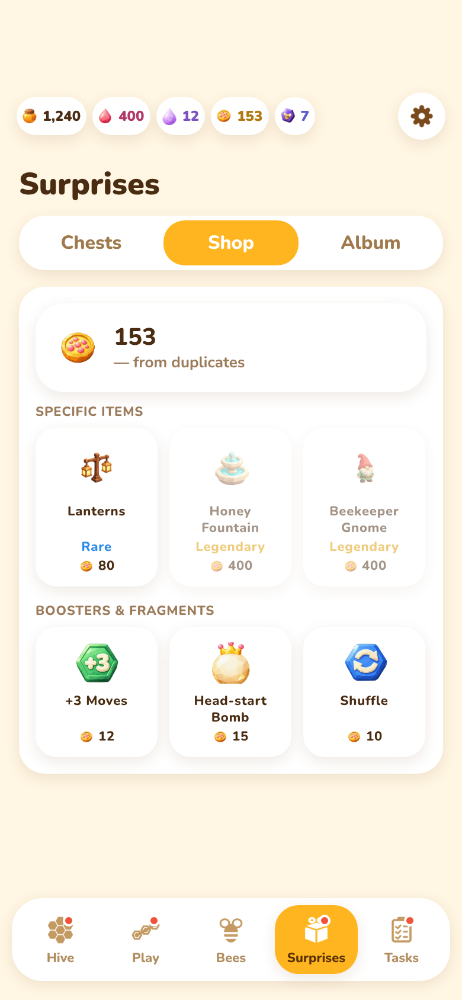 |

| Album | Tasks | Settings |
|---|---|---|
| 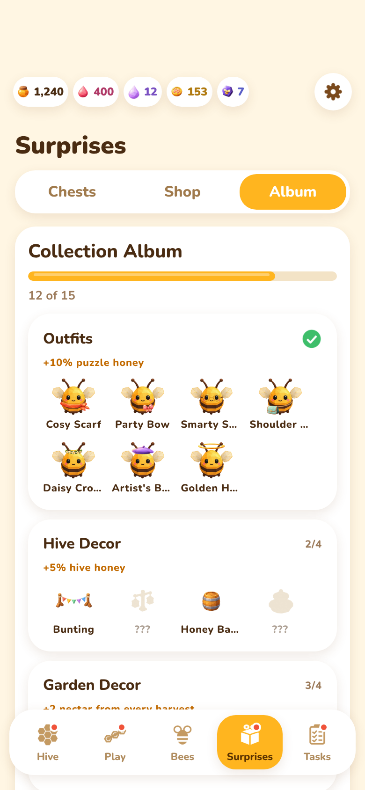 | 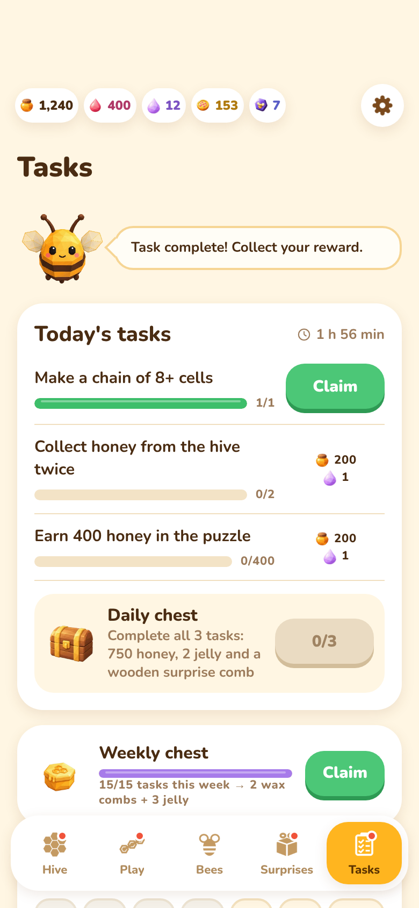 | 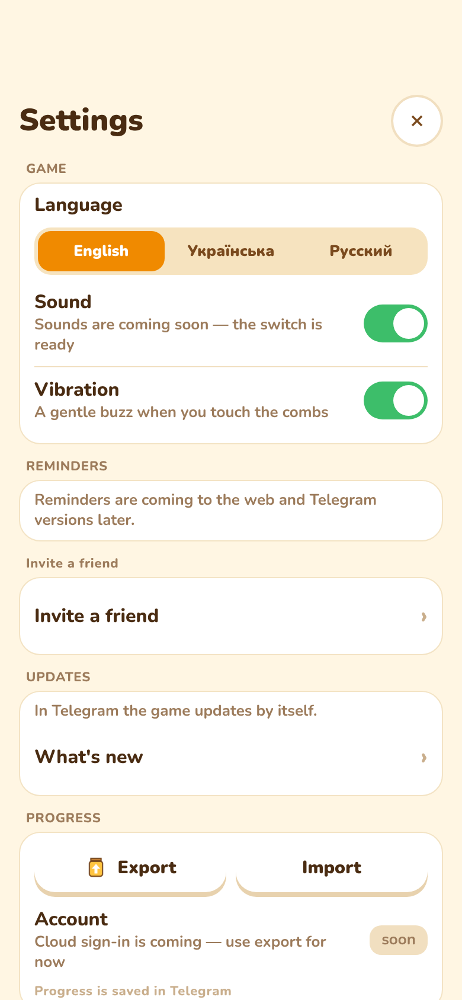 |

All screenshots are rendered from the real app code (react-native-web + Playwright, English UI, a fixture save).
They are reproducible with `scripts/web-screens/readme-shots.cjs` (see [Screenshots](#screenshots)).

## How the game is laid out

Five tabs at the bottom and the currencies (honey, nectar, royal jelly, pollen, Night-bee fragments) at the top.

| Tab | What is there |
|---|---|
| **Hive** | A **Combs / Garden** switch. Combs: the hive sign (level and honey per hour), the comb field with flying bees, decorations around it, the honey meter with **Collect** and the time until the hive is full, and the four hive upgrades right on the screen. Garden: beds in a 3-column grid, decorations on the grass, **Water all beds**. |
| **Play** | The daily puzzle, the colour of the day, free play (with a booster picker) and the weekend puzzle. |
| **Bees** | The collection (all bees face right, hover and flap their wings), outfits, the bee card with levels, renaming and outfit choice. |
| **Surprises** | Surprise combs (chests), the pollen Shop and the collection Album. |
| **Tasks** | Daily tasks and the daily chest, the weekly chest, the 7-day login calendar, streak freeze and statistics. |

Settings are a separate page (language, sound, vibration, reminders, invite a friend, updates, export/import, about).

## Features

- **Hive idle.** 19 comb slots on a hex grid. You build next to existing combs and upgrade each one up to level 40.
  Bees make honey offline up to the storage limit. Four hive upgrades: Worker Bees (up to level 30), Wax Pantry (12),
  Flower Meadow (30) and Queen's Chamber (10).
- **Honeycomb puzzle.** Drag across 3+ neighbouring cells of one colour. Chains of 6+ leave a royal-jelly bomb
  (bombs can chain-react), there are rainbow jokers and a combo multiplier for chains of 5+.
  - **Daily puzzle:** one seed per calendar day for everyone, 20 moves, 1–3 stars, day streaks.
  - **Weekend puzzle:** Saturday and Sunday, 30 moves, its own stars and rewards.
  - **Free play:** unlimited rounds with all bee bonuses. Before a round you pick boosters (+3 moves, a bomb at the
    start); a missing booster can be bought for pollen right there. Shuffle is used during the round.
  - **Under the board:** a **Hint** button that highlights a chain, a button that shows the colour of the day and a
    round summary.
- **13 bees** with permanent bonuses, unlocked with royal jelly (the 13th, the Night bee, is assembled from 10
  fragments). **Bee levels 1–10:** levelling costs nectar (plus royal jelly at levels 5 and 10); each level grows
  the bee's ability and adds +1% hive honey. Level 10 adds a crown. Bees can be renamed (up to 16 characters).
- **Outfits.** Scarf, bag, bow, glasses, wreath, beret and halo, drawn as separate layers per view, wearable by any
  bee.
- **Flower garden.** Up to 6 beds next to the hive (more unlock with honey). Plant sunflower, clover, lavender,
  cornflower or mint (plus rare moon poppy and golden sunflower), and water them. Flowers grow only while the soil is
  wet; one watering lasts 4 h. Timers run offline with clock-rollback protection. Flowers give **nectar** and +4%
  hive honey per planted bed. A planted flower of the **colour of the day** turns on ×1.5 for that colour in the
  puzzle.
- **Decorations.** Four hive decorations (bunting, lanterns, barrel, fountain) and four garden ones (mushroom, bench,
  pinwheel, gnome). Each has its own spot in the scene and a small animation. Tap a spot to put a decoration out or
  away; an empty spot shows a faint outline and links to the Shop. What decorations should *do* is planned for
  v1.5.5 (see the [roadmap](design/ROADMAP.md)).
- **Surprise combs.** Loot boxes for in-game play only, no purchases: wooden (3 daily tasks), wax (3★ daily puzzle,
  weekly chest, weekend puzzle), golden (every 7-day streak, 3★ weekend, a rare bonus inside wax or wooden combs) and
  royal (locked until seasons). Drops: honey, nectar, jelly, seeds, outfits, decorations, boosters and Night-bee
  fragments. Odds are shown in the game, with pity (epic in ≤10, legendary in ≤30 golden combs); duplicates become
  pollen for the Shop. Deterministic seeded RNG (no re-rolls), three-tap opening with bees gathering.
- **Daily and weekly loop.** 7-day login calendar with a chest, 3 daily tasks plus a daily chest, a weekly chest for
  15 tasks, streak freeze (4 jelly, once a week).
- **Living bees.** Bees fly curved loops around the hive, turn towards their flight direction (five views), land on
  combs to "work", swarm to the honey counter when you collect and zip across the board on big combos. Wings flap on
  one shared clock with a phase shift per bee; all motion runs on the native driver and pauses in the background.
- **Languages, updates, saves.** English (default), Ukrainian and Russian with proper plural forms; a language picker
  on first launch. On Android the app checks GitHub releases and installs updates from Settings. Saves can be
  exported and imported as a text code `BUZZLE1.…` with a checksum.
- Clock-rollback protection, tolerant save migrations with backups, haptics.

## What changed in v1.5

- New "honey crystal" art: environments for the hive and the garden, combs, puzzle tiles, plants, items, boxes,
  decorations and bees rebuilt from 2D turnarounds (`assets/art/turn/`).
- Hive screen: one sign for level and honey per hour, one honey meter with Collect and the time until full,
  upgrades visible on the screen instead of a hidden sheet, decorations standing in the scene.
- Garden: 3 beds per row, locked beds shown as empty plots with their price, plants growing *in* the bed (the bed's
  front rim is drawn over the stem), readable status chips for water and harvest.
- Bees: collection portraits in a three-quarter view facing right, hovering with flapping wings; a clear close button
  on the bee card.
- Puzzle: tight honey-crystal tiles with even gaps and empty sockets under them, rendered 1:1 (no stretching), no
  selection frame; the board always fits the screen. New under the board: a Hint button, the colour of the day and
  round stats.
- Progression: combs now go up to level 40 and the hive upgrades have doubled caps (30 / 12 / 30 / 10); prices and
  bonus formulas are unchanged, existing saves keep their levels.
- Free play: a booster picker before every round.
- Settings: a full page with a close button that respects the safe area; system/Telegram Back goes from a sub-page to
  the list first, then closes Settings.
- Comb field size no longer jumps when switching between Combs and Garden.

## Telegram Mini App (web)

Buzzle also runs as a **Telegram Mini App**: open [@Buzzle_game_bot](https://t.me/Buzzle_game_bot) and press
**Play**. The same build works in a normal mobile browser: https://inm1nd.github.io/buzzle/

- **Same code as Android.** Game logic and balance are identical; the web build comes from the same
  Expo / react-native-web code. The deployed Pages build is still 1.4.1; v1.5 goes live with its release.
- **Telegram integration** (`src/platform/telegram.ts`): `ready()`, `expand()`, `requestFullscreen()` on mobile
  clients, `disableVerticalSwipes()` so a puzzle drag never closes the app, header and background colours that follow
  the game, the Telegram **BackButton** mirroring in-app navigation (`src/platform/back.ts`), **HapticFeedback**
  (`src/ui/haptics.web.ts`) and safe-area insets (`src/platform/insets.ts`).
- **Saves.** Inside Telegram the save goes to **CloudStorage** and follows the account across devices. It is chunked
  into two alternating slots plus a meta key, so a broken write never damages the previous save
  (`src/platform/cloudSave.ts`). Writes are debounced and flushed when the app is hidden; `localStorage` is the cache
  and the store outside Telegram.
- **Reliable images.** Tab icons are inline data URIs (`src/ui/TabIcon.web.tsx`); all other art is loaded once and
  kept in memory with retries (`src/platform/pinArt.web.ts`).
- **Reminders** are not available on the web yet (no backend).

```bash
scripts/telegram/build-web.sh                 # -> dist-web/ (base path /buzzle; BZZ_WEB_BASE overrides)
NODE_PATH=/path/to/node_modules node scripts/telegram/smoke.cjs http://127.0.0.1:8098/buzzle/   # mocked Telegram + plain browser
scripts/telegram/deploy-pages.sh              # dist-web -> gh-pages branch (GITHUB_TOKEN_PUSH)
node scripts/telegram/setup-bot.mjs           # bot menu button, descriptions, /start (TELEGRAM_BOT_TOKEN)
```

## Tech stack

- **Expo SDK 57**, **React Native 0.86** (New Architecture, Hermes), **TypeScript**, react-native-web for the web
  build.
- Animations: React Native `Animated` with `useNativeDriver` only: pre-computed Catmull-Rom flight paths
  (`src/logic/flight.ts`), shared wing-flap clocks, no JavaScript per frame.
- `@react-native-async-storage/async-storage`, `expo-notifications`, `expo-haptics`, `expo-file-system` +
  `expo-intent-launcher` (in-app updates).
- Art: WebP layers. Bees are raster turnarounds (body, two wings, outfits per view) imported by
  `scripts/import_bee_layers.py`; the rest of the v1.5 art by `scripts/import_v15_art.py`. Nunito font (SIL OFL 1.1).
- Tests: `node:test` via `tsx` (game logic, puzzle, flight paths, i18n) and Jest + React Native Testing Library (UI).
- Local Gradle release build (no EAS): arm64-v8a only, R8 + resource shrinking, uncompressed 16 KB-aligned native
  libraries, APK signature schemes v1 + v2 + v3.

## Project layout

| Path | What |
|---|---|
| `src/logic/` | Pure game logic: hex grid, board/puzzle, economy, bees and levels, garden, loot, tasks, daily seed, notification plan, flight paths. |
| `src/screens/` | Hive, Garden, Play hub, Game round, Bees, Surprises, Tasks, Settings, box opening, modals. |
| `src/ui/` | Theme, components, `TurnBee` / `BeeSprite` (bee layers and animation), `DecorSpots` (decorations in the scene), reward flights. |
| `src/i18n/` | Translation keys and strings for en / uk / ru. |
| `src/platform/` | Web / Telegram bridge: WebApp SDK, Back button, safe areas, CloudStorage save, share, updater. |
| `assets/art/` | Runtime art: `turn/` (bee layers), `env/` (backgrounds and beds), `garden/`, `items/`, combs, tiles, icons. |
| `design/` | Roadmap ([`ROADMAP.md`](design/ROADMAP.md) in English, [`ROADMAP.ru.md`](design/ROADMAP.ru.md) in Russian), v1.5 UI mockups (`v1.5-ui/`), brand and Telegram art (`brand/`), art sources and studies (`2d/`, `3d/`, `art/`). |
| `scripts/` | Art importers, `simulate.ts` (balance bots), `configure-android.sh`, `verify-apk.sh`, web screenshot harness, Telegram tools. |
| `tests/`, `tests-rn/` | Logic tests and UI tests. |
| `screens/` | Screenshots: `v1.5/` (this README), older versions in subfolders. |

## Build

Requirements: Node 22, JDK 17, Android SDK + NDK (`env.sh` puts them on the PATH).

```bash
. ./env.sh
npm ci
npm run typecheck && npm test && npm run test:ui -- --runInBand

# release APK
CI=1 npx expo prebuild --platform android --no-install
bash scripts/configure-android.sh     # arm64-only, R8, stored 16 KB-aligned libs, release signing v1+v2+v3
cd android && ./gradlew assembleRelease --no-daemon --console=plain
cd .. && cp android/app/build/outputs/apk/release/app-release.apk Buzzle-v1.5.0-dev.apk
bash scripts/verify-apk.sh Buzzle-v1.5.0-dev.apk   # aapt, apksigner, zipalign -P 16, ELF alignment, JS bundle
```

### Balance

`npx tsx scripts/simulate.ts` runs casual (3 visits a day) and active (6 visits a day) bots through the real game
actions for 90 days. v1.5 does not change the economy formulas (it only raises the level caps); the table was measured before the higher
caps and covers the first 90 days, where they do not matter.

| Bot | all 12 bees | first L5 | all L5 | first L10 | all L10 | 6 beds |
|---|---|---|---|---|---|---|
| casual | day 32 | day 34 | day 44 | day 56 | day 80 | day 9 |
| active | day 14 | day 15 | day 21 | day 44 | day 62 | day 7 |

### Signing

Release signing reads `keystore/keystore.properties`, which is **not** in git. Copy
`keystore/keystore.properties.example`, put your keystore next to it and fill in your own passwords (see
`keystore/README.md`). Updates only install over an existing app signed with the same key, so keep a backup of the
keystore. Keystores, passwords, APKs and large build logs are git-ignored.

### Screenshots

```bash
bash scripts/telegram/build-web.sh /tmp/bzz-web
mkdir -p /tmp/srv && ln -sfn /tmp/bzz-web /tmp/srv/buzzle && (cd /tmp/srv && python3 -m http.server 8099 &)
NODE_PATH=/path/to/playwright/node_modules node scripts/web-screens/readme-shots.cjs http://127.0.0.1:8099/buzzle/
# full review set on 360/390/430 with overflow checks:
NODE_PATH=/path/to/playwright/node_modules node scripts/web-screens/v15-review.cjs http://127.0.0.1:8099/buzzle/
```

Set `BZZ_CHROME` to use a specific Chromium binary.

## License

MIT, see [LICENSE](LICENSE). Font: Nunito, SIL Open Font License 1.1 (`assets/fonts/LICENSE.txt`).
