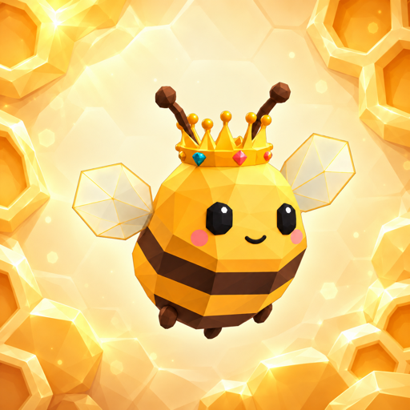
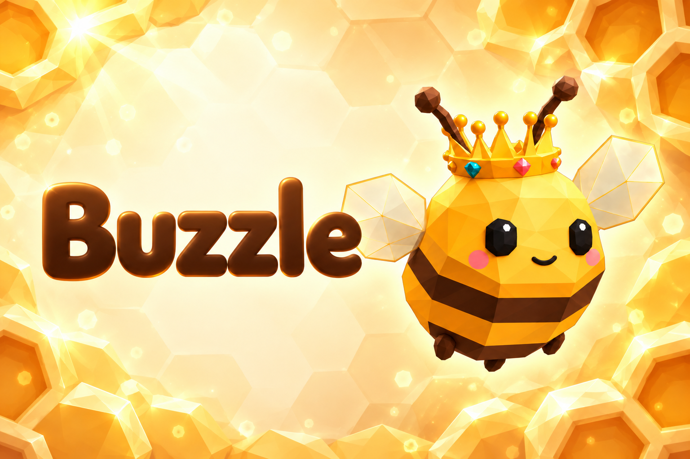
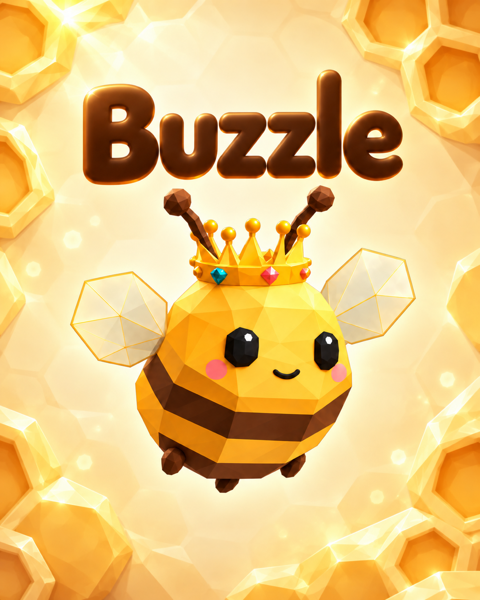

# Buzzle — оформление для Telegram, v1

В основе — действующая иконка `assets/icon-zhuzha.png` и медовый фон из `design/art/environment-honey-crystal-v1/hive-background.png`. Согласованные цвета, гранёная пчёлка с короной, светлый центр и соты по краям.

| Файл | Назначение |
|---|---|
| `telegram-icon-512.png` | Квадратная иконка / аватар для Telegram, 512×512 |
| `telegram-icon-1024.png` | Та же иконка, 1024×1024 |
| `icon-hive.png` | Исходное изображение иконки в полном разрешении |
| `poster-landscape.png` | Горизонтальный постер с названием Buzzle, 1536×1024 |
| `telegram-poster-1080x1350.png` | Вертикальный постер для публикации, 1080×1350 |
| `poster-portrait.png` | Исходное изображение вертикального постера в полном разрешении |
| `prompts.json` | Полные промпты и использованные референсы |

Изображения подготовлены встроенным image_gen; экспортные размеры получены уменьшением готовых изображений. Иконка без текста и без запечённых скруглённых углов: круг/скругление применяет сам Telegram. Постеры содержат только название Buzzle, поэтому подходят для всех языков приложения.

Проверены читаемость названия, границы персонажа и отсутствие обрезанных усиков/крыльев. Это пакет графики: изображения не опубликованы в Telegram, Android-иконка и рабочая игра автоматически не заменялись.

